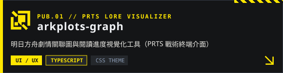
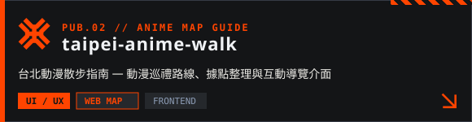
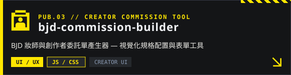
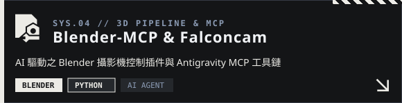

##  `// 01` 關於這個開發庫 · OVERVIEW 

這裡是個人日常創作與實驗用的開發筆記庫。  
主要專注於 **UI/UX 介面設計、前端切版（JS/TS、HTML、CSS）、Blender 3D 與日式二次元手繪美術**；其他跨語言實作與底層工具開發，皆習慣搭配 **AI / LLM** 協作完成。

| 項目 | 內容說明 |
| :--- | :--- |
| **`[ 視覺與美術 ]`** | **手繪圖 / 日式二次元風格、Blender 3D** — 角色與介面視覺設計、3D 場景與模型製作 |
| **`[ 前端與介面 ]`** | **UI/UX、HTML、CSS、JS / TS** — 網站與工具介面設計、主題風格切版（如方舟 PRTS / 終末地工業風） |
| **`[ AI 協作開發 ]`** | **AI / LLM 實戰應用** — 熟悉以 AI Agent 輔助程式開發、功能改造與日常創作工具整合 |

##  `// 02` 公開專案 · PUBLIC REPOSITORIES 

  
  

  
  

##  `// 03` 活動紀錄 · ACTIVITY 

  
  

