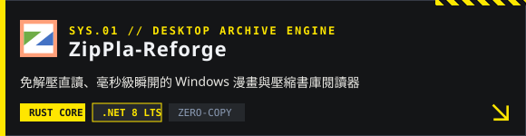

##  `// 01` 代表專案 · FEATURED SYSTEMS 

  
  

  
  

##  `// 02` 領域與工具鏈 · ENGINEERING MATRIX 

| 領域代號 | 技術棧與工具 | 核心專長 |
| :--- | :--- | :--- |
| **`[ NATIVE_CORE ]`** | `Rust` `C# (.NET 8)` `FFI / C-ABI` | 高效能原生引擎重構、零拷貝影像管線、跨行程隔離架構 |
| **`[ FRONTEND_UI ]`** | `TypeScript` `React` `Tailwind CSS` | 工業機能風設計系統（PRTS / Endfield Theme）、互動式節點圖表與地圖 |
| **`[ AI_3D_TOOLS ]`** | `Python` `Blender API` `MCP Server` | AI Agent 驅動之 3D 場景控制、自動化標註工具與工作流整合 |

##  `// 03` 遙測數據 · TELEMETRY & ACTIVITY 

  
  

  <picture>
    <source media="(prefers-color-scheme: dark)" srcset="https://raw.githubusercontent.com/JohnsonChung/JohnsonChung/output/endfield-snake.svg" />
    
  </picture>

